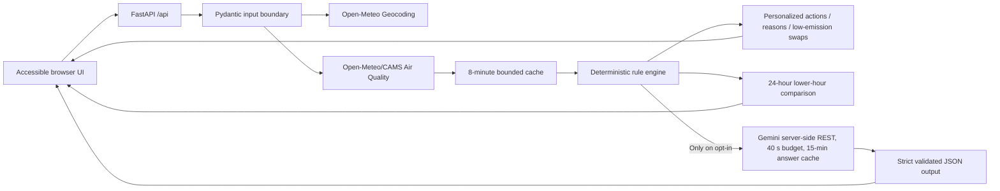

# AirWise — Urban Air Quality Decision Studio

> **PromptWars Virtual · Challenge 06 · Urban Air Quality Assistant**  
> *A source-grounded air-quality decision layer for households, commuters, outdoor workers, and communities.*


**Challenge:** Build a GenAI-powered assistant that helps families and communities navigate severe winter smog and urban air pollution. It must suggest **low-emission routines, indoor air improvements, sustainable alternatives personalized to location and lifestyle**, and explain *why each recommendation matters*.

AirWise is not another generic chatbot or a map that paints arbitrary numbers. It combines real external **modeled air-quality estimates** with deterministic, inspectable decisions and an **opt-in server-side Gemini narrative**. It never silently turns a model forecast into a government-monitored reading.

**Deployment:** https://airwise-promptwars-c6-897669266422.asia-south1.run.app  
**Demo video:** [Watch the AirWise demo on YouTube](https://youtu.be/TvnFK4hocVI)

## 1. Requirement traceability

Each clause of the challenge brief, where a user sees it, and the code and tests behind it.

| Brief requirement | Where you see it in the app | Code | Tests |
|---|---|---|---|
| GenAI-powered assistant | Opt-in Gemini briefing (`#aiContent`) and follow-up questions (`#askForm`) | `airwise/ai.py`; `/api/plan`, `/api/ask` in `airwise/main.py` | `tests/test_ai.py`, `tests/test_ask.py`, `tests/test_ai_resilience.py` |
| For families and communities | Persona selector (`#persona`: family, commuter, outdoor worker, neighbourhood group); shareable community brief (`#copyBtn`) | `ACTION_RULES` in `airwise/policy.py`; `static/js/brief.js` | `tests/test_policy_rules.py`, `tests/js/pure-modules.test.js` |
| Navigating winter smog where the user lives | City search (`#citySearch`) and shortcuts; current modeled US AQI, PM2.5, PM10 (`#aqiPanel`); 24-hour outlook chart and table (`#chart`, `#hourlyTable`) | `airwise/data.py`, `airwise/aqi.py`, `airwise/forecast.py` | `tests/test_data.py`, `tests/test_aqi.py`, `tests/test_forecast.py`, `scripts/browser_check.py` |
| Low-emission daily routines | Timing comparison for the planned activity (`#shiftResult`); routine and exposure cards (`#recommendations`) | `find_lower_hour` and `EXPOSURE_RULES` in `airwise/policy.py`; text in `airwise/catalog.py` | `tests/test_windows.py`, `tests/test_policy.py` |
| Indoor air-quality actions | "Build a cleaner-air room" and "No-purchase protection first" cards | `HOME`, `BUDGET` in `airwise/catalog.py` | `tests/test_policy_rules.py` |
| Sustainable alternatives | Sustainable swap cards (`#swaps`) | `SWAP_RULES` in `airwise/policy.py`; `*_SWAP` in `airwise/catalog.py` | `tests/test_policy_rules.py`, `tests/test_policy.py` |
| Tailored to location and lifestyle | Household flags (`#children`, `#older`, `#respiratory`), priorities, budget (`#budget`), outdoor hour and minutes (`#startHour`, `#outdoorMin`) | `Profile` in `airwise/models.py`; `Situation` and rules in `airwise/policy.py` | `tests/test_policy_rules.py`; rule-engine output recorded for 43,008 combinations ([verification record](docs/VERIFICATION.md)) |
| Clearly explaining the direct impact of each choice | "Why this matters" on every card; "Direct impact" on every swap; modeled PM2.5 averages and difference for the timing shift; decision trace (`#traceList`) | `Advice.why`, `TRACE_*` in `airwise/catalog.py`; `Shift` in `airwise/models.py` | `tests/test_policy.py`, `tests/test_windows.py` |
| No invented data | "DATA UNAVAILABLE" and a notice when the forecast fails; AI marked unavailable instead of faked | `ProviderError` in `airwise/data.py`; `snapshot_or_503` and `optional_briefing` in `airwise/main.py` | `tests/test_api.py`, `tests/test_edge_cases.py`, outage scenario in `scripts/browser_check.py` |

Design decisions and their trade-offs are recorded in [docs/DECISIONS.md](docs/DECISIONS.md).

### Four personas are not interchangeable

1. **Family:** school planning, vulnerable residents, indoor-source control and practical no-purchase options.
2. **Commuter:** avoidable car trips, congestion-adjacent waiting, alternative timing and exposure tradeoffs.
3. **Outdoor worker:** reasonable outdoor working practices, occupational safety context and exposure reduction, without unsupported medical or respirator claims.
4. **Neighborhood group:** no-idling practices, accessible cleaner spaces and source-labeled public information.

Use the person switches and priorities to show **the generated decision set actually changes**. It is not a prewritten response shown to everyone.

## 2. The architectural insight

**The language model does not compute the AQI, decide the scale, or invent exposure savings.** The server receives a model forecast, validates it, calculates the specific rules and timing comparison, and only then passes an evidence-constrained summary of the facts and vetted decisions to Gemini when the user opts in.



- **Data integrity:** Missing pollutant readings remain missing. We never automatically replace them with random data, a hardcoded demonstration value or a different AQI scale.
- **AQI terminology:** We display the **US EPA AQI** produced by Open-Meteo, **not India's CPCB AQI**. Their categories and pollutant calculation methods differ. The Indian CPCB index is **not** calculated or implied here.
- **Coarse model resolution:** CAMS global forecasts operate at far coarser spatial scales than individual streets. We do not claim to predict commute-route or indoor sensor concentrations.
- **Timing comparison:** The modeled difference is a percentage difference **in PM2.5 concentration at the same grid cell**, not a personal dose, CO2 saving, disease risk or proven exposure reduction.
- **Low-emission swaps:** Direct mechanisms are discussed but never turned into invented citywide AQI reductions or vehicle CO2 numbers.

Detailed architecture: [docs/ARCHITECTURE.md](docs/ARCHITECTURE.md). Threat model: [SECURITY.md](SECURITY.md).

## 3. Run locally

**Requirements:** Python 3.12+, Git, an optional Gemini Developer API key for real GenAI. The app has no database, frontend build step or runtime npm dependency; Node.js 22 is used only for the browser-code lint, format and unit-test tooling.

```bash
git clone https://github.com/pranavg21/airwise-promptwars-c6.git
cd airwise-promptwars-c6
python -m venv .venv
# Activate your virtual environment and then:
pip install -r requirements-dev.txt
uvicorn airwise.main:app --reload
```

Visit `http://127.0.0.1:8000`.

To activate real Gemini answers, set a **server-side** environment variable, e.g. on PowerShell:

```powershell
$env:GEMINI_API_KEY="YOUR_GOOGLE_AI_STUDIO_API_KEY"
$env:GEMINI_MODEL="gemini-2.5-flash"
uvicorn airwise.main:app --reload
```

On Linux/macOS, use `export GEMINI_API_KEY=...` and `export GEMINI_MODEL=gemini-2.5-flash` before launching. **Never put a key in HTML, browser JavaScript, a committed `.env` or the README.** If no key is configured, the deterministic policy still works, but the app correctly labels the AI feature unavailable instead of fabricating an AI response.

Optionally set `GEMINI_FALLBACK_MODEL` to a second model the project can use; it is tried only when the first model fails, for example after its daily quota is spent. Every setting is read in `airwise/config.py`.

The code default and the deployed model are `gemini-2.5-flash`. The identifier is configurable through `GEMINI_MODEL` because Google retires and reroutes models. Google has published lifecycle changes for the 2.5 family, so check the official [model deprecations page](https://ai.google.dev/gemini-api/docs/deprecations) and confirm structured responses from any replacement model before relying on it. Free-tier Gemini limits apply per Google Cloud project and per model, and daily limits reset at midnight Pacific time; the live limit for a project is shown in Google AI Studio.

## 4. Code map

| Path | Responsibility |
|---|---|
| `airwise/main.py` | HTTP routes and the per-request time budget for AI |
| `airwise/security.py` | Request guards (size, JSON-only, cross-site writes), security headers, rate limiting |
| `airwise/config.py` | Environment settings and every operating limit, with units |
| `airwise/data.py` | Open-Meteo geocoding and air-quality client: fixed hosts, timeouts, validation, caching |
| `airwise/aqi.py` | US EPA AQI categories, defined once |
| `airwise/forecast.py` | The 24-hour outlook (by elapsed time) and its lowest hour, defined once for the dashboard and the planner |
| `airwise/policy.py` | Ordered rules that select recommendations; duration-weighted timing comparison |
| `airwise/catalog.py` | Recommendation text, sources and decision-trace messages |
| `airwise/ai.py` | Gemini adapter: minimized context, schema and numeric-claim validation, deadline, answer cache, fallback model, failure diagnostics |
| `airwise/models.py` | Pydantic contracts for every request, forecast and response |
| `static/js/` | Typed with JSDoc and checked by TypeScript against `types.d.ts`, which mirrors the API models. One module per job: `app.js` wiring, `city-search.js`, `readings.js`, `plan.js`, `plan-view.js`, `chart.js`, `brief.js`, `transport.js` |
| `static/css/` | Seven stylesheets in cascade order, from `base.css` tokens to `responsive.css` |

## 5. Run the quality gates

```bash
pip install -r requirements-dev.txt
ruff check . && ruff format --check . && mypy
python -m pytest -q --cov=airwise --cov-branch --cov-fail-under=100
python -m scripts.mutation_check
pip-audit -r requirements.txt
python scripts/audit_repo.py
npm ci && npm run lint && npm run format:check && npm run typecheck && npm test && npm audit
pip install playwright==1.62.0 axe-playwright-python==0.1.8 && python -m playwright install chromium
python -m scripts.browser_check && python -m scripts.a11y_check
```

**Verification:** every push to `main` runs the [AirWise Quality Gate](https://github.com/pranavg21/airwise-promptwars-c6/actions) with three jobs. The Python job runs ruff (including a complexity limit of 10 per function), the formatter check, `mypy --strict`, the pytest suite with 100% statement and branch coverage required, a planted-bug check (14 deliberate defects the suites must catch), `pip-audit`, the repository audit and a single-branch check. The frontend job runs ESLint (complexity, function and file size limits), Prettier, strict TypeScript checking of the JavaScript (`tsc` with `checkJs` and `strict`), Node unit tests and `npm audit`. A separate CodeQL workflow scans the Python and JavaScript for security and quality issues. Every action is pinned to a commit SHA. The browser job runs desktop and mobile Chromium walkthroughs and axe-core scans with a keyboard walkthrough. Automated tests replace Open-Meteo and Gemini with controlled fakes, so they make no live provider calls. See [the verification record](docs/VERIFICATION.md) for what is covered, what was checked live, and what remains manual.

There is no client-side use of `innerHTML` to display API or GenAI strings; the UI creates text nodes.

## 6. Evaluation criteria and where to check them

| Criterion | Evidence in this repository |
|---|---|
| Code quality | Single-purpose modules (see the code map); rules separated from recommendation text; AQI categories and the 24-hour outlook each defined once and shared by the dashboard and the planner; `ruff` with complexity limit 10, `mypy --strict`, strict TypeScript checking of the browser JavaScript against `static/js/types.d.ts`, and ESLint complexity and size limits enforced in CI; shared browser-test harness in `scripts/harness.py` |
| Security | Key only in server environment and Secret Manager; strict Pydantic contracts reject unknown fields; fixed upstream hosts with timeouts and no redirects; CSP without inline script or style, HSTS, COOP, CORP and frame denial on every response (`tests/test_security.py`); cross-site API writes rejected; rate limits with `Retry-After`; Gemini failures logged without key, prompt or reply; `pip-audit`, `npm audit` and CodeQL in CI; actions pinned to commits; no `Server` header ([SECURITY.md](SECURITY.md)) |
| Efficiency | Forecast cached 8 minutes per rounded location; Gemini answers cached 15 minutes, keyed on the full grounding context (readings, decisions, profile and question), so a revised forecast never reuses an answer about an earlier decision; AI work bounded to 40 seconds so a request never outlives the browser's 45-second wait; no framework, build step, web fonts or third-party scripts |
| Testing | 154 Python tests with 100% statement and branch coverage enforced, 8 Node tests, desktop and mobile browser journeys (including an incomplete forecast, an apostrophe city search, a late Gemini answer and a failed Gemini answer that offers the rule-based plan), 8 axe scans and a keyboard walkthrough; `scripts/mutation_check.py` plants 14 bugs on every CI run and fails unless each is caught |
| Accessibility | Zero axe-core violations across 8 page states at 1366 px and 390 px (WCAG 2.2 AA and best-practice rules); Lighthouse accessibility 100; WCAG AA text contrast; keyboard city search with visible focus and announced results; skip link, labelled controls, data table for the chart, reduced-motion support (`scripts/a11y_check.py`) |
| Problem alignment | Families, commuters, outdoor workers and neighbourhood groups get different routines, indoor actions and sustainable swaps, each with its direct mechanism; duration-weighted timing for the planned activity; opt-in Gemini briefing and follow-up questions |

## 7. Google services used

- **Gemini Developer API** (`gemini-2.5-flash`): opt-in briefings and follow-up answers, called only from the server (`airwise/ai.py`).
- **Cloud Run** (`asia-south1`): serves the API and static frontend from one container, scaling to zero when idle.
- **Secret Manager:** holds the Gemini key; Cloud Run injects it into the container environment.
- **Cloud Build:** builds the container from source on `gcloud run deploy --source .`.

## 8. Deploy as one reproducible service

A single Docker service hosts both API and frontend, so no separate frontend deployment or cross-origin API configuration is needed.

**Option A — Google Cloud Run (production deployment):**

Deployed with dedicated runtime service account `airwise-runner` and server-side secret management:

```bash
gcloud run deploy airwise-promptwars-c6 \
  --source . \
  --region asia-south1 \
  --project venueflow-maps \
  --platform managed \
  --allow-unauthenticated \
  --port 8080 \
  --service-account airwise-runner@venueflow-maps.iam.gserviceaccount.com \
  --set-secrets GEMINI_API_KEY=airwise-gemini-api-key:latest \
  --set-env-vars GEMINI_MODEL=gemini-2.5-flash \
  --min-instances 0 \
  --max-instances 2
```

1. Live URL: `https://airwise-promptwars-c6-897669266422.asia-south1.run.app`
2. Secret `airwise-gemini-api-key` is securely injected from Secret Manager into container memory; no secret is exposed in client-side code, Git, or logs.
3. Open `https://airwise-promptwars-c6-897669266422.asia-south1.run.app/api/health` to confirm `status: ok` and `ai_configured: true`.
4. Scale-to-zero (`--min-instances 0`) avoids paying for idle instances. It does not by itself guarantee a zero bill; Cloud Build, Artifact Registry, Secret Manager and request charges depend on the project and its free-tier usage.

**Option B — any Docker host:**

```bash
docker build -t airwise-c6 .
docker run -p 8080:8080 -e GEMINI_API_KEY="YOUR_KEY" airwise-c6
```

You must point external HTTPS traffic to port 8080 and configure real TLS at the host or load balancer. The health endpoint is `/api/health`.

## 9. Challenge-specific submission rules

- **Public GitHub link** only; private/restricted links are not evaluated.
- **Repository below 10 MB** and **exactly one branch** (use `main`). The source itself is tiny; recheck history and `.git` before submission.
- **Working deployed HTTPS link**, publicly accessible without login.
- **Demo video under 4 minutes**, public Drive or unlisted YouTube with incognito playback verified.
- **Up to 3 attempts**; do not use one merely to test whether an unverified project will deploy.
- Submission form also asks for changes, GenAI service location, and a LinkedIn post URL. Drafts and placeholders are in [docs/SUBMISSION_FIELDS.md](docs/SUBMISSION_FIELDS.md).

### Repository-only checks to run immediately before submitting

```bash
git status --short
git branch -a
git ls-files | wc -l
python scripts/audit_repo.py
```

## 10. Demo storyboard

A suggested < 4-minute video that satisfies all published criteria: [docs/DEMO_SCRIPT.md](docs/DEMO_SCRIPT.md).

## 11. Assumptions and honest limitations

- For a small hackathon service, rate limits and the forecast and Gemini answer caches live in each process (at most two Cloud Run instances). Scale-out deployments need a shared rate-limit and cache service.
- The free Gemini tier allows a small number of requests per day per project and model. When it is used up, the app says so and the rule-based plan keeps working; repeated identical requests reuse the cached answer instead of spending quota.
- The app has **no login or database**. User preference settings are used for the request and not persisted by application code. Hosting and API providers may independently process service metadata.
- Google's endpoint may have regional quota, pricing and policy constraints. Real AI generation requires a valid key, network connectivity, availability and user opt-in. The application **does not promise AI works before actual deployment verification**.
- Street-level routing, official CPCB measured AQI, in-home sensor feedback, actual emissions saved, medical diagnosis and air-cleaner efficacy measurement are **not implemented**. They are not hidden behind marketing terms.
- Air quality estimates cannot substitute for local official warnings or personal clinical advice.

## 12. Citations, attribution and responsible use

- [Open-Meteo Air Quality API — CAMS attribution, variables, model spatial resolution](https://open-meteo.com/en/docs/air-quality-api)
- [Open-Meteo Geocoding API — GeoNames-based source](https://open-meteo.com/en/docs/geocoding-api)
- [WHO — Air pollution: Personal interventions and risk communication](https://www.who.int/news-room/questions-and-answers/item/air-pollution-personal-interventions-and-risk-communication)
- [US EPA — Reducing pollution from vehicles and engines](https://www.epa.gov/transportation-air-pollution-and-climate-change/what-you-can-do-reduce-pollution-vehicles-and)
- [US EPA — Idle-Free Schools Toolkit](https://www.epa.gov/schools/idle-free-schools-toolkit-healthy-school-environment)
- [US EPA — Sources of indoor particulate matter](https://www.epa.gov/indoor-air-quality-iaq/sources-indoor-particulate-matter-pm)
- [US EPA — Strategies to Reduce Exposure Indoors](https://www.epa.gov/wildfire-smoke-course/strategies-reduce-exposure-indoors)
- [CPCB — India's National AQI information](https://cpcb.gov.in/displaypdf.php?id=bmF0aW9uYWwtYWlyLXF1YWxpdHktaW5kZXgvQWJvdXRfQVFJLnBkZg%3D%3D)
- [Google Gemini API — model endpoint and structured output](https://ai.google.dev/api/generate-content)

*AirWise is an independent Challenge 6 project. It is not endorsed by Open-Meteo, CAMS, WHO, CPCB, Google or Hack2Skill.*
