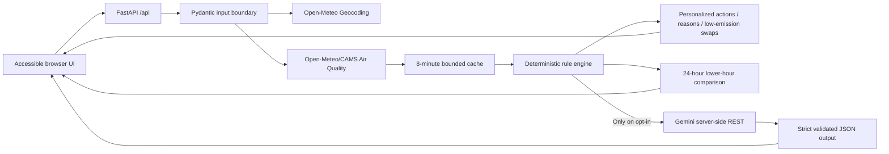

# AirWise — Urban Air Quality Decision Studio

> **PromptWars Virtual · Challenge 06 · Urban Air Quality Assistant**  
> *A source-grounded air-quality decision layer for households, commuters, outdoor workers, and communities.*


**Challenge:** Build a GenAI-powered assistant that helps families and communities navigate severe winter smog and urban air pollution. It must suggest **low-emission routines, indoor air improvements, sustainable alternatives personalized to location and lifestyle**, and explain *why each recommendation matters*.

AirWise is not another generic chatbot or a map that paints arbitrary numbers. It combines real external **modeled air-quality estimates** with deterministic, inspectable decisions and an **opt-in server-side Gemini narrative**. It never silently turns a model forecast into a government-monitored reading.

**Deployment:** https://airwise-promptwars-c6-897669266422.asia-south1.run.app  
**Demo video:** Add your actual unlisted YouTube or publicly accessible Google Drive URL after recording.

## 1. Key functionality and problem alignment

| Judge-relevant requirement | What actually works | Proof in repo |
|---|---|---|
| Location-aware advice | Search cities or select Delhi, Mumbai, Pune, Bengaluru; validated WGS84 coordinates | `airwise/data.py`, `airwise/models.py`, `tests/test_data.py` |
| Current urban pollution | Current **modeled** US AQI, PM2.5, PM10 from Open-Meteo/CAMS | `airwise/data.py`, `static/js/app.js` |
| 24-hour decision support | Modeled hourly AQI plot, accessible hourly table and lowest forecast hour | `airwise/policy.py`, `static/js/chart.js`, `tests/test_policy.py` |
| Personalized family guidance | Child, older-adult, respiratory-sensitivity, daily priorities and budget | `airwise/policy.py`, `tests/test_policy.py` |
| Low-emission daily routines | Context-aware trip reduction, less idling, school-run alternatives and collective actions | `PolicyResult.swaps` in `airwise/policy.py` |
| Indoor air improvements | Combustion-source reduction, caution around ventilation, optional filtration | `airwise/policy.py` |
| Direct impacts explained | Every protective and emissions-reducing suggestion includes the mechanism, reference and relevant limitation | `Advice.why`, `Advice.reference` |
| Actual generative AI | Gemini structured JSON for opt-in personalized daily brief and live follow-up questions | `airwise/ai.py`, `/api/plan`, `/api/ask` |
| Responsible failure behavior | No fabricated AQI during outage, no fake AI results when API key is absent, clear status | `tests/test_api.py`, `tests/test_ai.py` |
| Community use | Copyable source-attributed public bulletin that excludes household medical preferences, printable action plan | `static/js/app.js`, print CSS |
| Transparency | Source, data timestamp, indexing standard, limitations, traceable policy reasons | App methodology section and `docs/ARCHITECTURE.md` |

### Four personas are not interchangeable

1. **Family:** school planning, vulnerable residents, indoor-source control and practical no-purchase options.
2. **Commuter:** avoidable car trips, congestion-adjacent waiting, alternative timing and exposure tradeoffs.
3. **Outdoor worker:** reasonable outdoor working practices, occupational safety context and exposure reduction, without unsupported medical or respirator claims.
4. **Neighborhood group:** no-idling practices, accessible cleaner spaces and source-labeled public information.

Use the person switches and priorities to show **the generated decision set actually changes**. It is not a prewritten response shown to everyone.

## 2. The architectural insight

**The language model does not compute the AQI, decide the scale, or invent exposure savings.** The server receives a model forecast, validates it, calculates the specific rules and timing comparison, and only then passes an evidence-constrained summary of the facts and vetted decisions to Gemini when the user opts in.



- **Data integrity:** Missing pollutant readings remain missing. We never automatically replace them with random data, a hardcoded demonstration value or a different AQI scale.
- **AQI terminology:** We display the **US EPA AQI** produced by Open-Meteo, **not India's CPCB AQI**. Their categories and pollutant calculation methods differ. The Indian CPCB index is **not** calculated or implied here.
- **Coarse model resolution:** CAMS global forecasts operate at far coarser spatial scales than individual streets. We do not claim to predict commute-route or indoor sensor concentrations.
- **Timing comparison:** The modeled difference is a percentage difference **in PM2.5 concentration at the same grid cell**, not a personal dose, CO2 saving, disease risk or proven exposure reduction.
- **Low-emission swaps:** Direct mechanisms are discussed but never turned into invented citywide AQI reductions or vehicle CO2 numbers.

Detailed architecture: [docs/ARCHITECTURE.md](docs/ARCHITECTURE.md). Threat model: [SECURITY.md](SECURITY.md).

## 3. Run locally

**Requirements:** Python 3.12+, Git, an optional Gemini Developer API key for real GenAI. No npm dependencies, database or frontend build process.

```bash
git clone https://github.com/pranavg21/airwise-promptwars-c6.git
cd airwise-promptwars-c6
python -m venv .venv
# Activate your virtual environment and then:
pip install -r requirements-dev.txt
uvicorn airwise.main:app --reload
```

Visit `http://127.0.0.1:8000`.

To activate real Gemini answers, set a **server-side** environment variable, e.g. on PowerShell:

```powershell
$env:GEMINI_API_KEY="YOUR_GOOGLE_AI_STUDIO_API_KEY"
$env:GEMINI_MODEL="gemini-3.5-flash-lite"
uvicorn airwise.main:app --reload
```

On Linux/macOS, use `export GEMINI_API_KEY=...` and `export GEMINI_MODEL=gemini-3.5-flash-lite` before launching. **Never put a key in HTML, browser JavaScript, a committed `.env` or the README.** If no key is configured, the deterministic policy still works, but the app correctly labels the AI feature unavailable instead of fabricating an AI response.

The model identifier is configurable because Google can deprecate models. The default is Gemini 3.5 Flash-Lite. Verify model access with the deployed smoke check. Check the official [model deprecations page](https://ai.google.dev/gemini-api/docs/deprecations) if deployment fails.

## 4. Run the quality gates

```bash
python -m compileall -q airwise
python -m pytest -q --cov=airwise --cov-branch --cov-report=term-missing --cov-fail-under=80
python scripts/audit_repo.py
```

**Verification:** Eleven new regression tests passed locally. See [the verification record](docs/VERIFICATION.md) for versions, coverage limitations, browser checks and the hosted Gemini test.

There is no client-side use of `innerHTML` to display API or GenAI strings; the UI creates text nodes. We test validation, rate limits, modeled data parsing, sensitive profiles, unavailable sources, opt-in behavior, malformed AI output, the AQI category boundaries and sustainable-swap explanations.

See [docs/VERIFICATION.md](docs/VERIFICATION.md) for an adversarial go/no-go checklist.

## 5. Deploy as one reproducible service

A single Docker service hosts both API and frontend, so no separate frontend deployment or cross-origin API configuration is needed.

**Option A — Google Cloud Run (production deployment):**

Deployed with dedicated runtime service account `airwise-runner` and server-side secret management:

```bash
gcloud run deploy airwise-promptwars-c6 \
  --source . \
  --region asia-south1 \
  --project venueflow-maps \
  --platform managed \
  --allow-unauthenticated \
  --port 8080 \
  --service-account airwise-runner@venueflow-maps.iam.gserviceaccount.com \
  --set-secrets GEMINI_API_KEY=airwise-gemini-api-key:latest \
  --set-env-vars GEMINI_MODEL=gemini-2.5-flash \
  --min-instances 0 \
  --max-instances 2
```

1. Live URL: `https://airwise-promptwars-c6-897669266422.asia-south1.run.app`
2. Secret `airwise-gemini-api-key` is securely injected from Secret Manager into container memory; no secret is exposed in client-side code, Git, or logs.
3. Open `https://airwise-promptwars-c6-897669266422.asia-south1.run.app/api/health` to confirm `status: ok` and `ai_configured: true`.
4. Scale-to-zero (`--min-instances 0`) ensures $0 idle hosting costs within Google Cloud free tiers.

**Option B — any Docker host:**

```bash
docker build -t airwise-c6 .
docker run -p 8080:8080 -e GEMINI_API_KEY="YOUR_KEY" airwise-c6
```

You must point external HTTPS traffic to port 8080 and configure real TLS at the host or load balancer. The health endpoint is `/api/health`.

## 6. Challenge-specific submission rules

- **Public GitHub link** only; private/restricted links are not evaluated.
- **Repository below 10 MB** and **exactly one branch** (use `main`). The source itself is tiny; recheck history and `.git` before submission.
- **Working deployed HTTPS link**, publicly accessible without login.
- **Demo video under 4 minutes**, public Drive or unlisted YouTube with incognito playback verified.
- **Up to 3 attempts**; do not use one merely to test whether an unverified project will deploy.
- Submission form also asks for changes, GenAI service location, and a LinkedIn post URL. Drafts and placeholders are in [docs/SUBMISSION_FIELDS.md](docs/SUBMISSION_FIELDS.md).

### Repository-only checks to run immediately before submitting

```bash
git status --short
git branch -a
git ls-files | wc -l
python scripts/audit_repo.py
```

**Do not submit this working-directory ZIP directly** as your GitHub URL. Create a public repository, push the project, verify the exact public URL in incognito, deploy and record a fresh video.

## 7. Demo storyboard

A suggested < 4-minute video that satisfies all published criteria: [docs/DEMO_SCRIPT.md](docs/DEMO_SCRIPT.md).

## 8. Assumptions and honest limitations

- For a small hackathon service, per-process rate limiting and in-memory cache are used. Scale-out deployments need a shared quota/rate-limit service and upstream observability.
- The app has **no login or database**. User preference settings are used for the request and not persisted by application code. Hosting and API providers may independently process service metadata.
- Google's endpoint may have regional quota, pricing and policy constraints. Real AI generation requires a valid key, network connectivity, availability and user opt-in. The application **does not promise AI works before actual deployment verification**.
- Street-level routing, official CPCB measured AQI, in-home sensor feedback, actual emissions saved, medical diagnosis and air-cleaner efficacy measurement are **not implemented**. They are not hidden behind marketing terms.
- Air quality estimates cannot substitute for local official warnings or personal clinical advice.

## 9. Citations, attribution and responsible use

- [Open-Meteo Air Quality API — CAMS attribution, variables, model spatial resolution](https://open-meteo.com/en/docs/air-quality-api)
- [Open-Meteo Geocoding API — GeoNames-based source](https://open-meteo.com/en/docs/geocoding-api)
- [WHO — Air pollution: Personal interventions and risk communication](https://www.who.int/news-room/questions-and-answers/item/air-pollution-personal-interventions-and-risk-communication)
- [US EPA — Reducing pollution from vehicles and engines](https://www.epa.gov/transportation-air-pollution-and-climate-change/what-you-can-do-reduce-pollution-vehicles-and)
- [US EPA — Idle-Free Schools Toolkit](https://www.epa.gov/schools/idle-free-schools-toolkit-healthy-school-environment)
- [US EPA — Sources of indoor particulate matter](https://www.epa.gov/indoor-air-quality-iaq/sources-indoor-particulate-matter-pm)
- [US EPA — Strategies to Reduce Exposure Indoors](https://www.epa.gov/wildfire-smoke-course/strategies-reduce-exposure-indoors)
- [CPCB — India's National AQI information](https://cpcb.gov.in/displaypdf.php?id=bmF0aW9uYWwtYWlyLXF1YWxpdHktaW5kZXgvQWJvdXRfQVFJLnBkZg%3D%3D)
- [Google Gemini API — model endpoint and structured output](https://ai.google.dev/api/generate-content)

*AirWise is an independent Challenge 6 project. It is not endorsed by Open-Meteo, CAMS, WHO, CPCB, Google or Hack2Skill.*
